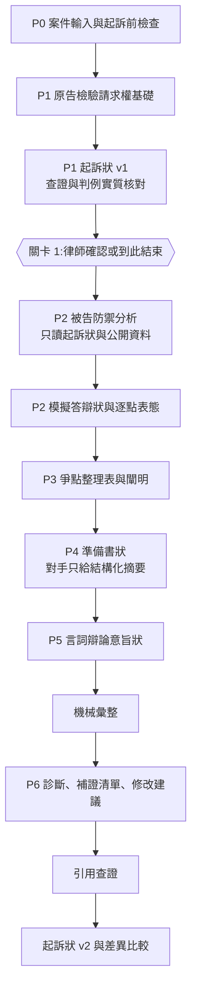

# LegalDebate 改版規格:以書狀交換重構對抗式架構(v0.2)

| 項目 | 內容 |
|---|---|
| 版本 | v0.2,2026-11-01,取代 v0.1 討論稿 |
| 基準 | 分支 `pleading-exchange`,commit `cf6f98c`(含 M1–M15),再搬入 `retrieval-optimization`(`e8404f7`)的檢索引擎 |
| 檢索 | 組員負責,介面見 [retrieval-interface.md](retrieval-interface.md);該文件列為檢索負責的檔案,本分支不直接改 |
| 實作計畫 | [pleading-exchange-plan.md](pleading-exchange-plan.md) |
| 法條 | 2026-11-01 用 `engine/verify.py` 對全國法規資料庫核對,見附錄 A |
| 限制 | 本文件的法律判斷沒有經執業律師確認,待確認項目列在第 10 節 |

---

## 0. 摘要

對抗式架構不變,但每一輪對抗都要留下一份實務文件。

| 階段 | 角色 | 產出 |
|---|---|---|
| P0 | 程式 | 起訴前檢查報告 |
| P1 | 原告 | 起訴狀 v1 |
| 關卡 1 | 律師 | 修改並確認起訴狀,或到此結束 |
| P2 | 被告(紅隊) | 模擬答辯狀與逐點表態表 |
| P3 | 法官 | 爭點整理表與闡明問題 |
| P4 | 雙方 | 準備書狀(模擬攻防) |
| P5 | 雙方 | 言詞辯論意旨狀(模擬攻防) |
| P6 | 法官 | 弱點診斷、補證清單、起訴狀修改建議,再產起訴狀 v2 |

**定位**:以對抗式書狀交換產生書狀的工作流,每份起訴狀先經 AI 對手打過一輪。

**給律師的主要交付物**:起訴狀 v1、補證清單、起訴狀 v2。其他文件是壓力測試的過程紀錄,畫面預設收合,避免增加閱讀量。

**第一期只做原告模式**。被告模式(上傳真實起訴狀)留到決賽後,但資料欄位 `represented_side` 從一開始就保留。

---

## 1. v0.2 與 v0.1 的差異

| # | v0.1 | v0.2 | 依據 |
|---|---|---|---|
| 1 | P1 引用維持 draft,又保留 `_assert_all_published`,書狀會落不了地 | 每份書狀落地前先跑機械查證。起訴狀 v1 另做判例實質核對,因為律師可能到此就停 | `database/db.py` `record_pleading` |
| 2 | `claim_amount` 必填數字,50 萬以下阻擋 | 金額可空白,標「待確認」;程序類型一律只警示,不阻擋 | 決賽兩件示範案的 `claims` 都沒有金額;第 427、436 條之 8 |
| 3 | ≤10 萬一律小額 | 小額限金錢、代替物或有價證券;第 427 條第 2 項事件不問金額;價額由法院核定 | 第 77 條之 1、427、436 條之 8 |
| 4 | 被告不得否認證據存在,違者退回 | 取消。新增 `authenticity`(爭執文書真正)表態 | 第 357 條:私文書應由舉證人證其真正 |
| 5 | 表態只有 admit、deny | 增加 `to_confirm`。模擬被告沒有當事人事實,實務上也有不知或不記憶的陳述 | 第 280 條第 2 項;M10 資料紀律 |
| 6 | `admit` 直接變不爭執事項 | 只有附證據編號的事實才能 `admit`,畫面標「預期不爭執(模擬)」 | 模擬被告不能代當事人自認;第 279 條 |
| 7 | 起訴狀 v2 修改要標第 255 條 | v2 在起訴前,訴狀尚未送達,不適用。第 255 條標記只用在模擬的 P4、P5 | 第 255 條第 1 項「訴狀送達後」 |
| 8 | 證據編號用「原證」 | 用「甲證 1」,被告「乙證 1」,編號恆定 | 司法院《民事訴訟資料標準化須知》 |
| 9 | 爭點表格式自訂 | 對齊官方四張表:聲明與請求權基礎清單、不爭執事項、爭點整理表、證據清單 | 司法院民事準備書狀範例、標準化須知例示 3–5 |
| 10 | 答辯聲明沿用自行整理的文字 | 改用司法院範例文字,結構照範例 | 司法院民事答辯狀範例 |
| 11 | 司法院答辯狀範例要下載進 repo | 不放檔案,範本結構寫進程式並附來源 | 已核對範例內容,不需要多一個檔案 |
| 12 | 書狀全文由模型排版 | 當事人欄、聲明框架、證物欄、此致由程式組成,模型只交內容 | 商工資料直接進當事人欄,不經 LLM |
| 13 | 事實與編號放 JSON,律師編輯後會對不上 | 編號寫進正文 `〔CF1〕`,匯出時移除;逐點表態以律師確認版的正文為準 | 關卡 1 允許自由編輯 |
| 14 | `internal_analysis` 等新欄位 | 不用這類命名。新範本只交結果與依據 | Claude 官方拒絕處理文件 |
| 15 | P4 起就全文互看 | 決賽前維持結構化摘要,全文互看放在最後一項,有餘裕才做 | 現有講法與防趨同設計;全文互看沒有測過 |
| 16 | 基準寫「43 個測試」 | 基準是離線 383 項 | 搬入檢索後實跑 |
| 17 | 沒提到 M12–M15 | 沿用自承引述檢查、準備清單、內部檢討隔離、法官預檢 | `main-finals-fix-list.md` |
| 18 | P1 讀立場檢索詞與本地語料 | 用檢索指令查官網與快取,範本放 `{RETRIEVAL_RULES}`、`{RETRIEVAL_CACHE_DIR}`、`{SEARCH_LOG_PATH}`;立場檢索詞改選用 | `retrieval-interface.md` 第四節 |
| 19 | 第 255 條比對 `cited_statutes` | 比對前後兩份 `basis` 清單 | `retrieval-interface.md` 第九節 |
| 20 | 判決引用只查字號存在 | 正式引用的判決附 `precedent_notes`,程式比對摘句與文件身分 | `engine/verify.py` `verify_precedent_note` |
| 21 | 無法連線的狀態沒有定義 | 全系統用 `network_error`,不代表查無 | 新引擎的狀態名 |
| 22 | 同字號多份文件沒有定義 | `ambiguous`,要指定 `doc_date`,否則不放行 | `engine/verify.py` |

---

## 2. 實務流程依據

台灣民事第一審的書狀順序已核對條文,差異設計都以此為準。

| 文件 | 依據 | 重點 | 對應 |
|---|---|---|---|
| 起訴狀 | 第 244 條 | 當事人及法定代理人、訴訟標的及原因事實、聲明;管轄與程序事項宜記載 | P1 |
| 起訴審查 | 第 249 條 | 可補正者定期間命補正;當事人不適格屬第 2 項 | P0 |
| 答辯狀 | 第 266 條第 2、3 項、第 267 條第 1 項 | 答辯事實及理由、證據、對他造主張之事實及證據為承認與否之陳述,應分別具體記載;收受訴狀後 10 日內提出 | P2 |
| 自認與視同自認 | 第 279、280 條 | 準備書狀內自認無庸舉證;言詞辯論時不爭執視同自認;不知或不記憶由法院審酌 | P2 表態 |
| 爭點整理 | 第 268 條之 1、第 270 條之 1 | 整理並協議簡化爭點;可命提出摘要書狀;協議原則上有拘束力 | P3 |
| 闡明 | 第 199、199 條之 1 | 得主張數項法律關係而不明瞭或不完足時應曉諭 | P3 |
| 準備書狀 | 第 265、267 條第 2、3 項 | 記載攻防方法並通知他造;再為主張或答辯的書狀收受後 5 日內提出 | P4 |
| 言詞辯論意旨狀 | 民事訴訟書狀規則第 3 條 | 法院命提出時,得指定格式、頁數或字數。沒有法定統一格式 | P5 |
| 失權與適時提出 | 第 196、276 條 | 逾時提出或未於準備程序主張,原則受限 | P3、P4 |
| 訴之變更追加 | 第 255、256 條 | 訴狀送達後原則不得變更追加,有 7 款例外;補充更正陳述不算 | P4、P5 |

**不主動替被告抗辯**的法律理由:時效完成後由債務人拒絕給付(民法第 144 條第 1 項),屬被告要主張的事項。「起訴狀通常不寫」是實務習慣,我們沒有查到可引用的實務指引,列為待確認。

---

## 3. 定位與邊界

| | 現行 | v0.2 |
|---|---|---|
| 核心 | 攻防模擬器,書狀是副產品 | 書狀工作流,攻防是產生與驗證書狀的引擎 |
| 第一個產物 | 跑完全程才有骨架 | P1 就有起訴狀 v1 |
| 被告資訊 | 讀全部案件事實 | 只讀起訴狀、列為證據的文件與公開資料 |
| 成本 | 每件跑完整條 | 可以只跑到 P1 |

不變的邊界:
- 只供律師或事務所內部使用,產出是草稿,一定經律師審核。
- 模型以民事第一審通常程序設計;其他程序只警示,畫面說明本系統沒有模擬其簡化流程。
- 法官評估不是判決預測,不給勝訴機率。
- 模型不得編造事實或證據。被告的推測只能標 `hypothetical`,不得進入原告方任何交付書狀。

**對外用語**:P2–P5 的文件一律標「模擬」,回應的是系統模擬的對手,不是對方實際書狀。

---

## 4. 流程



三劇本與關卡 2 是最後才做的擴充(第 5.8 節),做好時插在防禦分析與答辯狀之間。

**無人值守**:不指定停止點時關卡 1 自動通過,紀錄標「未經律師確認」,這樣才能事先跑好示範案。

---

## 5. 各階段規格

### 5.1 P0 案件輸入與起訴前檢查

| 欄位 | 必填 | 說明 |
|---|---|---|
| `represented_side` | 是 | 第一期固定 `plaintiff` |
| `case_type` | 是 | 案由 |
| `parties` | 是 | 兩造名稱、統編(法人) |
| `facts_summary` | 是 | **我方主張的事實經過**,沿用現有欄位,不新增 `narrative` |
| `claims` | 是 | 請求內容 |
| `claim_amount` | 否 | 整數;非金錢請求或未定時留空 |
| `evidence[]` | 否 | `id`(甲證 N)、`type`、`date`、`description`、`proves`(待證事實) |
| `opponent_known_responses[]` | 否 | `source`、`date`、`text` |
| `known_gaps[]` | 否 | 律師自己知道的缺口 |

沒有證據清單時可以繼續,但會警示:事實只能對應主張經過,也不會有預期不爭執事項。

**`engine/precheck.py` 只產生提示,不下結論,不阻擋**:

| 檢查 | 規則 | 輸出 |
|---|---|---|
| 商工查核、命補正、管轄 | 沿用 `gcis.py`、`party_issues.py`、`court_map.py` | 沿用 |
| 程序類型 | 空白:待確認。金額 ≤10 萬:可能小額(限金錢、代替物或有價證券)。≤50 萬:可能簡易。另依案由關鍵字提示第 427 條第 2 項,例如道路交通事故、票據。一律附「價額由法院核定」 | warn |
| 強制調解 | 依案由關鍵字對照第 403 條第 1 項,例如第 7 款交通事故與醫療糾紛、第 8 款僱傭、第 9 款合夥;財產權 ≤50 萬對照第 11 款。附第 424 條逕行起訴視為調解聲請 | warn |
| 時效 | 依案由提示民法第 125–127、197 條可能適用;有證據日期時列最早日期與距今年數。文字固定為「可能涉及時效,請律師確認」 | warn |
| 勞動事件 | 案由含勞資、僱傭時提示另有勞動事件法規定,本版不判斷 | warn |

關鍵字對照會誤判也會漏判,所以只提示。對照表要請律師校對。

### 5.2 P1 原告:請求權基礎檢驗與起訴狀 v1

分成兩個 subagent,分析範本維持已驗證過的版本,撰狀交給新的小範本。

**分析(`stage1_prompt.txt`,落地為 `DebateArgument` stage=1)**:沿用四步驟與 M10、M15。移除被告段落,加入 `evidence[]`、`opponent_known_responses`、`known_gaps`。不再給 `{STATUTES_DIR}`、`{JUDGMENTS_DIR}`,改放三個檢索佔位符。

檢索路徑(第 5.9 節):快照 `.../retrieval_cache/plaintiff`,紀錄 `.../search_logs/plaintiff_p1.jsonl`。記憶中的判決只能當線索;連線失敗時相關內容寫「待確認」。

**撰狀(新 `complaint_prompt.txt`)**:輸入是濾掉內部檢討的分析、案件資料、起訴前檢查。只交結果:

```json
{
  "cause": "返還借款",
  "prayers": ["被告應給付原告新臺幣100萬元,及自起訴狀繕本送達翌日起至清償日止,按週年利率百分之五計算之利息。",
              "訴訟費用由被告負擔。", "願供擔保,請准宣告假執行。"],
  "claim_basis": [{"seq": 1, "role": "primary", "basis": ["民法第478條"], "prayer": "訴之聲明第一項"},
                  {"seq": 2, "role": "alternative", "basis": ["民法第179條"], "prayer": "訴之聲明第一項"}],
  "fact_points": [{"id": "CF1", "text": "原告於112年3月1日匯款100萬元至被告帳戶。", "evidence_ids": ["甲證1"], "statement_quote": null},
                  {"id": "CF2", "text": "兩造約定三個月內返還。", "evidence_ids": [], "statement_quote": "三個月還"}],
  "legal_argument": "要件與事實的涵攝(繁體中文)",
  "procedural_statements": [{"id": "plaintiff:dissolved", "text": "原告已解散,法定代理人待查明"}],
  "basis": ["民法第478條", "民法第179條"],
  "citations": ["民法第478條"],
  "precedent_notes": [{"citation": "最高法院○年度台上字第○號", "doc_date": "YYYYMMDD", "doc_type": "判決", "case_cause": "返還借款",
                       "quote": "全文中的原句", "proposition": "支持什麼命題"}],
  "fact_gaps": ["借貸合意的書面證據待確認"],
  "lawyer_notes": ["待確認金額不列入聲明"]
}
```

**程式組成正文(`engine/pleading_render.py`)**,結構照司法院起訴狀範例:
- 案號、承辦股別留待填;訴訟標的金額或價額由 `claim_amount` 帶入,沒有就留待填。
- 當事人欄由商工查核結果帶入。有 bad 等級事項時法定代理人寫「清算人(待查明:…)」,不經 LLM。
- 事實段每點結尾加 `〔CF1〕`,匯出時移除。
- 證物名稱及件數由 `fact_points` 用到的證據產生。
- 法院、日期留待填。

**起訴狀不主動討論被告抗辯**。預想的抗辯留在分析的內部檢討與 `lawyer_notes`。

**機械關卡(`main.py complaint`)**:
- 每個 `fact_point` 要有存在的 `evidence_ids`,或 `statement_quote` 逐字出現在 `facts_summary`。硬擋,退回撰狀 subagent,最多 2 次;對應不到的應移到 `fact_gaps`。
- `ex_officio` 事項沿用 `cured_in` 檢查分析段落。
- `citations` 全部 published 才落地(`_assert_all_published`)。
- `lint_pleading` 命中只警告,照實列入回報。

**查證時機**:撰狀後先跑 `main.py verify --precedent-notes <檔> --snapshot <案件快照根目錄>`,程式比對文件日期、文種、案由與摘句;`quote_not_found`、`ambiguous`、`network_error` 都不放行。再開乾淨 subagent 核對判例實質支持,結果存 `structured_json.citation_review`。畫面分開顯示「存在性已查證」「摘句已比對」「實質核對結果」。

### 5.3 關卡 1

- 律師可用現有編輯器另存新版,原稿不動。新段落沒有 `〔CF…〕` 時提示「不會進逐點表態」,不阻擋。
- 「到此結束」:案件停在這裡,可匯出。
- 「確認並繼續」:記錄採用哪一版,再以續跑開新 run。後續一律讀這一版。
- 律師版有引用未通過時不能確認繼續,先重新查證或移除。

### 5.4 P2 被告:防禦分析與模擬答辯狀

**程式產生角色檔 `main.py role-view --role defendant`**,被告只拿到這份:

| 給 | 不給 |
|---|---|
| 律師確認版起訴狀全文(去除 CF 以外的系統說明) | `facts_summary` 中沒有寫進起訴狀的部分 |
| 起訴狀用到的證據描述 | 原告分析與內部檢討 |
| `opponent_known_responses` | `known_gaps`、`lawyer_notes`、`fact_gaps` |
| 商工查核與程序事項 | 未列入起訴狀的證據 |

**防禦分析(新 `defense_stage1_prompt.txt`,落地為 `DebateArgument` stage=1)**:由現行被告段落改寫。保留抗辯窮舉與 M10 的「若被告能提出 X」寫法。先依字號讀起訴狀引用的判決,再搜起訴狀的請求權基礎與抗辯。檢索路徑用 `.../retrieval_cache/defendant` 與 `.../search_logs/defendant_p2.jsonl`,撰狀與劇本共用同一個紀錄檔。

**撰狀(新 `answer_prompt.txt`)**:

```json
{
  "responses": [
    {"fact_id": "CF1", "stance": "admit", "ground": null, "reason": null, "hypothetical": false},
    {"fact_id": "CF2", "stance": "deny", "ground": "insufficient_proof", "reason": "匯款僅證明交付,不足以證明借貸合意", "hypothetical": false},
    {"fact_id": "CF3", "stance": "authenticity", "ground": null, "reason": "LINE 截圖傳送者是否為被告本人,原告應證其真正", "hypothetical": false},
    {"fact_id": "CF4", "stance": "to_confirm", "ground": null, "reason": "需被告本人說明,模擬被告沒有此資訊", "hypothetical": false}
  ],
  "defenses": [{"type": "payment", "statement": "若被告能提出清償紀錄,主張已清償", "legal_basis": ["民法第309條"], "hypothetical": true}],
  "legal_argument": "答辯理由(繁體中文)",
  "citations": ["民法第309條"],
  "to_confirm": ["是否另有代墊款紀錄"]
}
```

`ground` 可為 `insufficient_proof`(主攻舉證不足)或 `alternative_explanation`(對同一事實提出另一解釋,必須 `hypothetical: true`)。這兩類與「抗辯」是工作分類,沒有查到可引用的官方定義,待律師確認。

**程式組成正文**:結構照司法院答辯狀範例,答辯聲明用範例文字「駁回原告之訴及其假執行之聲請」「訴訟費用由原告負擔」「如受不利之判決,願供擔保請准宣告免為假執行」。`claims` 沒有假執行聲請時調整第一項。第三項是否保留由律師決定。副標固定寫「模擬答辯,非針對實際起訴狀」。

**機械關卡(`main.py answer`)**:
- 律師確認版正文的每個 `〔CF…〕` 都要有且只有一筆 `responses`。硬擋,退回撰狀 subagent,不得由編排者代寫。
- `admit` 只能用在該事實附有證據編號時。硬擋。
- `alternative_explanation` 必須 `hypothetical: true`;`deny`、`authenticity`、`to_confirm` 的 `reason` 不得為空。硬擋。
- `authenticity` 對到非文書證據時警告。
- `citations` 全部 published 才落地。

### 5.5 P3 法官:爭點整理表與闡明

法官讀 `role-view --role judge`:起訴狀、答辯狀、逐點表態、證據清單、程序事項。不讀 `facts_summary`、不讀任何內部檢討。

```json
{
  "undisputed": [{"id": "U1", "text": "原告於112年3月1日匯款100萬元至被告帳戶", "source": ["CF1"], "evidence": ["甲證1"]}],
  "issues": [
    {"id": "I1", "kind": "fact", "text": "系爭匯款是否基於消費借貸合意", "from": ["CF2"],
     "plaintiff_claim": "兩造約定三個月內返還", "plaintiff_evidence": ["甲證2"],
     "defendant_defense": "匯款僅證明交付", "defendant_evidence": [],
     "legal_basis": ["民法第478條"], "burden": "plaintiff", "hypothetical": false},
    {"id": "I2", "kind": "defense", "text": "若被告主張已清償,是否可採", "from": [],
     "plaintiff_claim": "", "plaintiff_evidence": [],
     "defendant_defense": "若被告能提出清償紀錄", "defendant_evidence": [],
     "legal_basis": ["民法第309條"], "burden": "defendant", "hypothetical": true}
  ],
  "clarifications": [{"target_side": "plaintiff", "question": "如不構成消費借貸,是否另依不當得利請求?",
                      "basis": "民事訴訟法第199條之1", "based_on": "I1"}],
  "questions": [{"question_text": "…", "target_side": "defendant", "based_on": "I1:…"}]
}
```

**程式檢查(`main.py issue-sheet`,硬擋)**:
- `undisputed.source` 全部要是 `stance = admit`。`to_confirm` 與沒提到的都不得列入。
- `issues.from` 的編號要存在;`clarifications.based_on` 要指到存在的爭點。
- `burden` 只能是 `plaintiff`、`defendant`、`undetermined`。
- 官方程序事項維持原格式:`based_on` 以「官方事實層(<id>):」開頭。
- 沿用 M12 自承檢查、M13 準備題與被告只問法律題。

**畫面呈現官方四張表**:聲明與請求權基礎清單(程式由起訴狀產生)、預期不爭執事項、爭點整理表、證據清單(程式由案件資料產生)。欄位對齊標準化須知例示 3–5:序次、爭點、原告主張、原告證據、被告抗辯、被告證據、法律依據。推測內容另外標示。

**禁止突襲**:法官想適用雙方未主張的法律關係,只能放 `clarifications`,不得直接進 P6 評估。P6 引用的法律關係沒有出現在書狀或闡明中時,程式警告,不硬擋。

### 5.6 P4、P5 準備書狀與言詞辯論意旨狀

落地仍是 `DebateArgument` stage=2、3,所以 `aggregate.py`、UI、續跑不用重寫。

**範本修改**:
- 公開論證依爭點組織,每段以 `【爭點 I1】` 開頭,回應闡明問題。
- 保留現有四步驟、M10、M15、falsifier、對造判例查核。
- 對手資料維持結構化摘要,但來源改成對造的書狀,不沿用現行 Step 4 從 `public-args` 摘對造 stage 1。v2 的 stage 1 是 P1、P2 的分析,不是書狀:原告分析的公開段落仍有事實經過與沒列進起訴狀的證據,被告讀到就破了 P2 的隔離。
  - P4:原告拿模擬答辯狀與逐點表態,被告拿律師確認版起訴狀,雙方都拿爭點整理表與闡明。
  - P5:另給對造 P4 的摘要(`position`、最強論點逐字一句、引用),只摘對造 stage 2。準備書狀本來就會送達對造,寫進去的事實可以給。
- 輸出新增 `basis` 清單。
- 檢索紀錄 P4 用 `<side>_p4.jsonl`、P5 用 `<side>_p5.jsonl`,查詢加 `--issue <爭點 id>`。P5 只深化既有爭點,這是系統收斂設計,不寫成法律禁止引用新法條。

**程式組成書狀(`main.py brief --side X --round 2|3`)**:標題、當事人欄、爭點段落、四張表的引用,全部由程式從已落地內容組成,不多開 subagent。落地為 `pleading_type = brief` 或 `closing`、`is_simulated = 1`。

**檢查**:
- 每個非推測的爭點,雙方都要有對應段落。硬擋,退回同一 subagent 1 次。
- 第 255 條:比對起訴狀與本輪的 `basis`,原告新增項目時警告律師確認屬變更追加或第 256 條補充。不從 `cited_statutes` 猜,也不硬擋。
- 推測內容寫進公開段落時,要保留「若被告能提出」或「推測」字樣。關鍵字檢查,只警告。

### 5.7 P6 診斷與起訴狀 v2

法官讀 `role-view --role judge`、雙方 stage 2、3 的公開論證與 `finalize --for-judge`。不給 stage 1:原告分析的公開段落等於間接給了事實經過,和 5.5「法官不讀 `facts_summary`」不一致;要補的事實由律師看 `fact_gaps` 決定。`risk_map` 保留舊鍵,新增:

| 鍵 | 內容 |
|---|---|
| `issue_assessment[]` | 每個爭點的強、中、弱與理由,不給勝訴機率 |
| `evidence_todo[]` | 爭點 id、缺什麼、為什麼 |
| `complaint_revisions[]` | 要改的 `CF`、建議新增的備位、建議刪除的不利陳述 |
| `fact_gaps[]` | 彙整各階段的事實缺口 |
| `opponent_hypotheticals[]` | 被告推測的事實,提醒律師向當事人確認 |

`Verdict.protocol_version` 為 `v2-pleading-exchange`。沿用 M9 讓步條件逐條回應、M12 自承檢查、第 249 條與 115 台抗 105 不得同括號。

**起訴狀 v2(新 `revision_prompt.txt`)**:輸入是確認版起訴狀與 `complaint_revisions`,輸出格式同 P1。
- 走同一套事實對應檢查。新事實對應不到就進 `fact_gaps`,不進正文。
- 程式比對 `hypothetical` 內容,被告推測不得寫進 v2。
- `parent_id` 指向確認版,`source = system_revision`。v2 只是建議版,律師決定是否採用。

畫面顯示 v1 與 v2 差異,由伺服器用 `difflib` 產生。

### 5.8 擴充項目(主線通過後才做)

**三劇本與關卡 2**:新 `scenario_prompt.txt`,輸出 `scenarios[]`:`id`、`title`、`layers_used`、`core_attack`、`target_fact_ids`、`hypothetical_facts`。律師勾選後才寫答辯狀,未選的保留在報告。無人值守時選 `target_fact_ids` 最多的一個,標「系統預選」。

**全文互看**:P4、P5 對手改讀公開書狀全文。要先對照 run 結果看有沒有趨同,沒有資料不預設更好。

### 5.9 檢索接法

| 階段 | 角色 | 紀錄檔 | 檢索 |
|---|---|---|---|
| P0、P3、P6、獨立查證 | 程式、法官、查證 | 無 | 不搜尋;法官可用 `judgment <字號>` 讀雙方已引用的判決 |
| P1 | 原告 | `plaintiff_p1.jsonl` | 主要檢索 |
| P2 | 被告 | `defendant_p2.jsonl` | 主要檢索 |
| P4 | 雙方 | `<side>_p4.jsonl` | 補充檢索,依爭點 |
| P5 | 雙方 | `<side>_p5.jsonl` | 少量 |

- 案件資料夾 `database/live_runs/case-<案件 ID>/`,底下 `retrieval_cache/<side>/`、`search_logs/`。關卡續跑沿用同一個資料夾。
- 每個角色只拿自己的快照與紀錄路徑。查證與落地用案件快照根目錄。
- UI 實跑由 `server/live_run.py` 設 `LEGAL_DEBATE_RUN_SNAPSHOT`,並禁止 agent 用 Read、Grep、Glob 直接讀快取與紀錄。同一程序的角色共用權限,所以角色之間仍靠 prompt 紀律,事後用稽核確認。
- 查詢預算由指令依紀錄檔名計算。
- 示範案要排除來源裁判,否則被告可能搜到原案答案。這需要組員提供新參數,未提供前用檢索紀錄稽核,讀到來源裁判的那次不能拿來講命中。

---

## 6. 資料契約

| 資料表 | 變更 |
|---|---|
| `Case` | 新增 `protocol`(NULL=舊流程、`v2`)、`represented_side`、`claim_amount`、`evidence_json`、`opponent_responses_json`、`known_gaps_json`、`gates_json` |
| `PleadingDraft` | 新增 `pleading_type`(NULL 依 `side` 推定)、`round`、`is_simulated`、`structured_json`;`source` 增加 `system_revision` |
| `IssueSheet`(新) | `case_id` 唯一、`undisputed_json`、`issues_json`、`clarifications_json`、`created_at` |
| `CourtQuestion` | 新增 `issue_id` |
| `LiveRun` | 新增 `stop_after` |
| `DefenseScenario`(新,擴充項目) | `case_id`、`scenario_id`、`content_json`、`selected`、`selected_by` |

所有新欄位都可為 NULL,`_sync_schema` 會自動補欄位。舊紀錄不動。新表要加入 `server/seed.py` 的 `_TABLES`,否則匯出示範資料會遺失。

---

## 7. 機械關卡總表

**原則:結構規則可以硬擋,自然語言規則只警告。**

| 類型 | 關卡 | 處理 |
|---|---|---|
| 保留 | 未 published 引用不得落地;已落地不可覆寫;falsifier 必填;程序補正必須回應;第 249 條與 115 台抗 105 不同括號;自承類用語要引述原句;法官預檢與退回上限 | 沿用 |
| 硬擋 | 事實對應證據編號或逐字引述;逐點表態涵蓋全部 CF;`admit` 要有證據;不爭執事項只能來自 `admit`;參照編號要存在;爭點段落涵蓋 | 新增 |
| 警告 | 程序類型、調解、時效;`lint_pleading`;文書真正對到非文書;第 255 條;推測字樣;P6 法律關係未經闡明 | 新增 |

同一份輸出最多退回 2 次,共 3 次。不得由編排者代寫。

---

## 8. 模型輸出規則

依 Claude 官方拒絕處理文件:`reasoning_extraction` 常見於要求把推理逐字或以固定格式放進輸出,例子包含 scratchpad、私人筆記、推理流水帳,以及名為 `reasoning`、`thinking`、`trace` 的欄位。可以要求簡短說明、結果的證據、動作摘要。文件沒有明文保證結果型欄位安全,以下是我們依文件精神的推論,要靠實跑驗證。

- 新範本只要結果與依據,不要求寫出步驟,不用 `analysis`、`reasoning`、`thinking`、`trace`、`internal`、`scratch` 命名。
- `stage1`–`stage3` 的「依序寫出步驟」與 `【內部檢討】` 已知有風險,但有 A/B 依據,先不動。第二批實跑若中止變多,就把內部檢討改成 `lawyer_risks` 結果型欄位,並移除步驟寫法。
- 每次實跑記錄每個 subagent 的中止次數。
- 中止時照 SKILL 同範本重派 2 次。官方建議改 prompt 而不是重試,但 #4 重派成功過,所以保留上限,連續中止就改範本。

---

## 9. 相容性

- `protocol` 為 NULL 的案件維持舊畫面與舊資料,可以重播,Step 9C 補產移到 `.claude/skills/legal-debate/references/legacy-v1.md`。
- UI 新案件一律 `v2`。`data/cases/` 舊輸入可以用,`facts_summary` 視為我方主張,並警示可能含被告抗辯。
- `resume_plan`、`pipeline_missing`、`_progress`、`get_case_detail` 依 `protocol` 分流。
- 舊錄製案不會變成新流程,決賽示範要有新案件。

---

## 10. 待確認與未查到

| 項目 | 現況 | 處理 |
|---|---|---|
| 起訴狀不主動討論抗辯是否為多數律師習慣 | 只查到時效屬抗辯的法條依據,沒有實務指引 | 不宣稱是實務共識,請律師確認 |
| 主攻舉證不足、提出另一解釋、抗辯的分類 | 查到匯款不足以證明借貸合意的裁判,沒查到這套分類的官方定義 | 當工作分類,不對外當法律定義講 |
| 言詞辯論意旨狀的統一格式 | 書狀規則只說法院得指定格式、頁數或字數 | 用官方準備書狀結構加上標題,標「本系統整理」 |
| 調解、時效、簡易事件的關鍵字對照 | 條文已核對,對照是我們自己寫的 | 只提示,請律師校對 |
| 標準化須知的現行適用情形 | 查到的是 108 年 5 月版,適用於行集中審理等情形 | 當格式參考,不說法院一定採用 |
| 勞動事件法 | 沒有核對條文 | 只提示另有規定 |
| 全文互看會不會趨同 | 沒有資料 | 不預設 |
| 新檢索對流程時間與花費的影響 | 沒有 Claude 全程實跑 | W8 量測後才能講 |
| `retrieval-rules` 指令 | 組員實作中,本分支還沒有 | 見實作計畫 |
| 引用設計(核心與備位、判決掛要件) | 組員討論稿第七節待定 | 決賽前只採 `basis`,其餘留到決賽後 |

---

## 附錄 A:條文核對

2026-11-01 以 `engine/verify.py` 比對全國法規資料庫,狀態 published。

**民事訴訟法**:第 77 條之 1、116、196、199、199 條之 1、244、249、251、255、256、265、266、267、268 條之 1、270、270 條之 1、276、277、279、280、357、390、392、403、406、424、427、436 條之 8、447 條。

**民法**:第 125、126、127、144、179、197、203、229、233、309、478 條。

## 附錄 B:來源

- [民事訴訟書狀規則](https://law.moj.gov.tw/LawClass/LawAll.aspx?pcode=B0010027):第 3 條,114 年 8 月 29 日修正。
- [司法院民事答辯狀範例](https://www.judicial.gov.tw/tw/dl-51178-e3e42336644b47fba46ee184f11f9fc2.html)
- [司法院民事準備書狀範例](https://www.judicial.gov.tw/tw/dl-51184-d6194e5d78f64c33b9e93cbf95cfeb88.html):列出四張表。
- [民事訴訟資料標準化須知](https://judgment.judicial.gov.tw/sys_FILES/民事訴訟資料標準化須知.pdf):證據編號恆定原則、例示 3–5。
- [Claude 拒絕與備援文件](https://platform.claude.com/docs/en/build-with-claude/refusals-and-fallback)
- 本機語料:`corpus/pleadings/reference/` 司法院起訴狀範例;`corpus/judgments/` 中「不爭執事項」「借貸意思表示」的用法。
